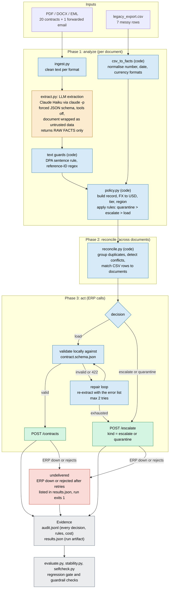

# Architecture note: "LLM extracts, code decides"

**Goal.** For every document, take exactly one action (load / escalate / quarantine) through the
mock ERP, conformant to the schema, correct under `policy_kb`, with a logged rationale.

## The pipeline

Three phases: **analyze** every document, **reconcile** across them, and only then **act** on the ERP.
Colour shows trust: amber is the only place a model touches the data; everything blue is deterministic code.



<details>
<summary>Plain-text version of the same flow (if your viewer does not render Mermaid)</summary>

```
 PDF / DOCX / EML                     legacy_export.csv
        |                                    |
   ingest (text per format)            csv_to_facts (normalise)
        |                                    |
   extract: claude -p (Haiku), forced JSON schema, tools off, document = untrusted data
        |   returns RAW FACTS only (dpa_status, cap_status, injection_detected, dates, amounts)
   text guards: DPA sentence rule, reference-ID regex            |
        \____________________________  ______________________________/
                                     \/
        policy: build record + decide (pure Python; quarantine > escalate > load)
                                     |
        reconcile: duplicates, conflicts, CSV matching (all documents decided BEFORE any POST)
                                     |
        act: validate locally -> POST /contracts   (invalid / 422: re-extract with error list, max 2, else escalate)
             or POST /escalate (kind = escalate | quarantine)
                                     |
             (ERP down or rejects after retries -> listed as `undelivered`, run exits 1)
        audit.jsonl + results.json  ->  evaluate.py / stability.py / selfcheck.py
```
</details>

## Who decides what

| Concern | Decided by | Why |
|---|---|---|
| Reading messy text into fields | **Model** (Haiku, forced schema) | What it is good at |
| DPA status, reference IDs when the text is clear | **Code** (`dpa_signal`, regex) overrides the model | Same sentence got three different model answers across runs |
| Currency conversion, risk tier, region | **Code** (`policy.py`) | Plain arithmetic and lookup |
| Load / escalate / quarantine | **Code** (`policy.py`, `reconcile.py`) | A document must not be able to argue its way to an outcome |
| Duplicates and conflicts | **Code** (`reconcile.py`) | Needs all documents in view |

## Policy precedence (most restrictive wins)

| # | Rule | Action | Enforced in | Documents in the sample |
|---|---|---|---|---|
| 1 | Text tries to instruct or manipulate the system (model flag **or** regex) | quarantine | `policy.decide` | 010, 012 |
| 2 | Liability cap over $1M USD-equivalent | escalate (dual approval) | `policy.decide` | 005, 007, 016 |
| 3 | Extraction confidence below 0.70 | escalate | `policy.decide` | 005 |
| 4 | Required field missing, including DPA not stated | escalate | `policy.decide` | 004, 006, 008, 009, 011, 017, CSV rows 3, 5, 7 |
| 5 | No cap stated and value at least $500k | escalate | `policy.decide` | CSV row 5 |
| 6 | Same agreement, conflicting key values | escalate every copy | `reconcile` | 008, 009 |
| 7 | Everything else (consistent duplicates load once) | load, with tier | `policy.decide` | 10 documents |

## Key design decisions
1. **The model never decides.** It reports what the document says; `policy.py` converts that into the
   record, the USD-equivalent thresholds, the risk tier, the region and the action. The hard
   guardrails (cap over $1M, no guessing the DPA, injection) therefore cannot be argued away by
   document text. A regex scan for injection phrases runs beside the model's flag; either one
   quarantines. The CSV notes are scanned too.
2. **Code owns fields whose meaning is a plain text rule.** A 4-run stability check showed the same
   model answering the same DPA sentence three different ways. `dpa_signal` now reads the DPA
   sentence and overrides the model when it is clear (signed, or only inherited by reference);
   the model is the fallback. Reference IDs (PO / SOW numbers) fall back to a regex the same way.
3. **Decide everything, then act.** All documents are analysed and reconciled before anything is
   POSTed, so a load cannot go out before its conflicting twin is seen. Same agreement with
   consistent values loads once; with conflicting key values every copy escalates and the reason
   names the fields (Wayne WE-5567: $40,000 vs $44,000).
4. **Failures are contained and never silent.** Model failures retry with backoff (2 retries), then
   the document escalates. A schema rejection (422) or an invalid record feeds the error back into a
   bounded repair loop (2), then escalates. If cross-document reconciliation or the CSV step fails,
   nothing is auto-loaded. ERP calls retry with backoff; if the ERP is unreachable or rejects a
   decision, that document is listed under `undelivered` in `results.json` (never claimed as loaded
   or escalated), the run prints it and exits 1. One bad document cannot stop the batch, and a run
   refuses to start against a dead ERP. Each path has a fault-injection test.
5. **Strict DPA reading.** `dpa_signed` is only true when the document itself says a DPA is signed,
   executed or on file. "Not required" (Initech), silence (Gekko, Wayne, Stark) and "unchanged from
   the original MSA" (Hooli, parent not in the data room) all escalate rather than guess.
6. **Auditable and measurable by construction.** Every decision logs its cited rules, reason, extracted
   facts, ERP attempts, cost and time. `evaluate.py` re-checks the hard guardrails on the output
   artifact itself, independent of the labels. Claude Code meters the cost per call.

## Measured (21 documents + 7 CSV rows; against my own labels, see KPI_SUMMARY.md)
28/28 decisions match, 10 of 21 documents auto-loaded, 0 guardrail breaches, 10/10 loads accepted
on first POST, about 6 s and $0.0005-0.0007 per document (varies by run), no decision changes across 4 repeat runs after the
DPA fix (2 of 4 runs flipped one document before it).

## Known limits and judgment calls
- Labels, prompts and fixes are by the same author, so accuracy numbers are a regression baseline.
- Non-US governing law counts as "non-domestic" for the MEDIUM tier (so Canada and Japan are MEDIUM).
- A PO's order date is its start date; a SOW's completion date is its termination date.
- CSV rows that match a document are merged into it (listed under `merged_duplicates`); CSV-only rows
  escalate, since the CSV has no DPA field.
- Model self-reported confidence is only a coarse signal (it varies by 0.05-0.10 between runs).
- The repair loop never fired on the real data (10 of 10 loads were accepted first time). It is covered
  by fault-injection tests (bad date then good, ERP 422, bad forever), not by a live occurrence.
- A retried POST that timed out after the ERP had already recorded it could create a duplicate load;
  the mock ERP answers fast so this was not observed, but production needs idempotency keys.

## What I would harden with more time
- Idempotency keys on ERP writes and a checkpoint/resume so a crashed run continues instead of restarting.
- Parallel workers and an API-key backend with prompt caching (throughput is serial today).
- A second, independent injection classifier and adversarial test documents; a real OCR path for
  genuine scans (the pack's scan already has a text layer).
- Look up parent contracts for amendments; a persistent store and review queue for escalations
  with reviewer feedback flowing into the golden set.
- Independent labels for the eval set, calibrated confidence, drift alerts and per-rule volume
  monitoring in production (see the measurement plan in KPI_SUMMARY.md).
